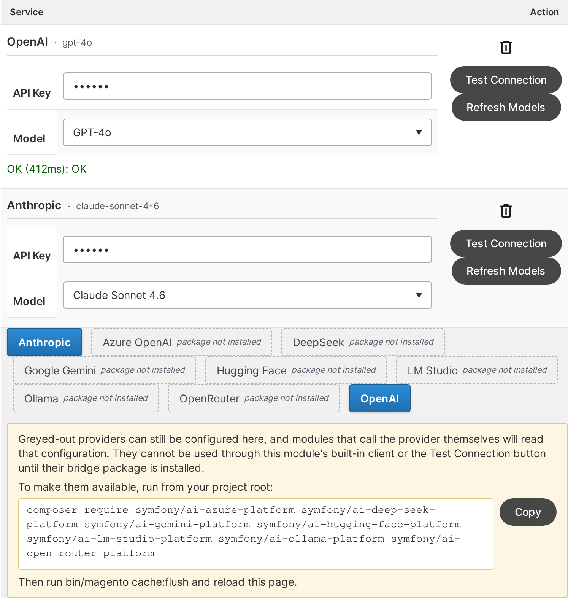
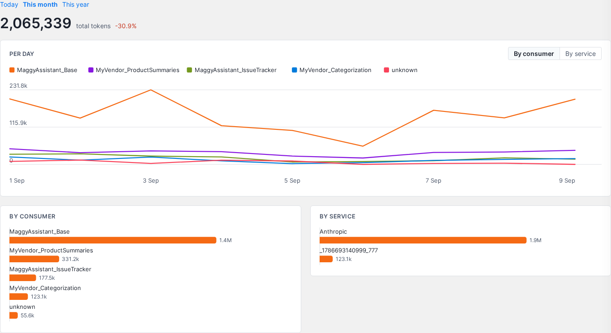

# Mage-OS AI Base

One place in Magento to configure your AI providers, one client every module can use to call them,
and a dashboard that shows what each module spends.

<table>
  <tr>
    <td width="50%"><a href="docs/images/admin-configuration.png"></a></td>
    <td width="50%"><a href="docs/images/admin-usage-dashboard.png"></a></td>
  </tr>
  <tr>
    <td align="center">Stores &gt; Configuration &gt; Mage-OS &gt; AI Configuration</td>
    <td align="center">Reports &gt; AI Token Usage</td>
  </tr>
</table>

## What it provides

- **Provider configuration.** OpenAI, Anthropic, Google Gemini, Azure OpenAI, DeepSeek, OpenRouter, Opper,
  Hugging Face, Ollama, LM Studio, OpenCode Zen, a self-hosted OpenCode server and any
  OpenAI-compatible gateway. Add a provider more than once,
  name each row, switch rows off, test the connection and refresh the model list from the form. API
  keys are encrypted at rest and never shown again.
- **One client for every provider.** Chat, streaming, tool calls and reasoning through a single
  interface. Options like `max_tokens` and `tool_choice` are translated per provider, and failures
  come back as typed exceptions you can retry or skip.
- **Let the admin choose.** A ready-made source model for your own `system.xml`, so a store picks
  which configured service your feature uses.
- **Usage tracking.** Token counts per module, service and store, on a dashboard, a grid and a CLI
  report. Prompts and responses are never stored.
- **Extensible.** Add your own provider with one class and a few lines of `di.xml`.

## Installation

```bash
composer require mage-os/module-ai-base
bin/magento module:enable MageOS_AiBase
bin/magento setup:upgrade
```

Requires Magento 2.4.8+ or Mage-OS 1.1+, and PHP 8.2+. OpenAI and Anthropic work out of the box; every
other provider needs its Symfony AI bridge package, which the admin form names when it's missing.

Two bridges do not come from Symfony, which has released none for OpenCode: Mage-OS ships
`mage-os/library-ai-opencode-zen-platform` (the hosted OpenCode Zen gateway) and
`mage-os/library-ai-opencode-custom-platform` (a self-hosted `opencode serve` instance). They are
optional like the rest, and the admin form names them the same way.

**OpenCode Custom** talks to your own opencode server rather than a hosted API. Its credential is
the server's password (`OPENCODE_SERVER_PASSWORD`), models are named `providerID/modelID` exactly
as the server routes them (`anthropic/claude-sonnet-4-6`), and **Refresh Models** lists every model
the server has configured. Every call opens a throw-away session with the agent's own tools
switched off and all permissions denied, then deletes it. Tools your module offers still work: the
bridge describes them in the prompt and parses the model's calls back out, with reliability
depending on the model. The universal `max_tokens` / `temperature` / `top_p` / `stop` options are
accepted but dropped, because the server applies its own limits. If Magento runs in Docker, start
the server with `--hostname 0.0.0.0` and a password, and use `http://host.docker.internal:4096` as
the base URL. Set **Agent** to a plain agent defined in the server's own config: the default agent
injects opencode's own system prompt and the `AGENTS.md` of the directory the server runs in, which
leaks into answers.
The module only adds admin screens, so it works the same with Luma, Hyvä or a headless storefront.

The client is built on [symfony/ai-platform](https://github.com/symfony/ai) 0.15, which is
experimental. This module's `Api` interfaces absorb its changes; code that reaches the Symfony
platform directly does not.

## Getting started

1. Go to **Stores > Configuration > Mage-OS > AI Configuration** and open **Services**.
2. Click **Add Service**, choose your provider, for example **OpenAI**, paste the API key and pick a
   model.
3. Click **Save Config**. Test Connection and Refresh Models only work on saved rows.
4. Click **Test Connection** on the row. It sends a short prompt and shows the latency and the
   reply. A failure says whether the key was rejected, the host was unreachable or the provider is
   rate limiting you.
5. Open the module that uses AI and pick this service in its own settings. Modules that offer
   **Automatic** use the first enabled service in the list whose provider is installed.
6. After the first calls, **Reports > Mage-OS AI > AI Token Usage** shows the tokens each module used.

## Configuration

### Stores > Configuration > Mage-OS > AI Configuration > Services

Scope: Default, Website and Store View. Each row is one configured service; add the same provider
more than once for separate accounts or models. The pencil names a row, and the toggle takes it out
of use without deleting its key.

| Provider | Fields |
|----------|--------|
| OpenAI, Anthropic, Google Gemini, DeepSeek, OpenRouter | API Key, Model |
| Azure OpenAI | API Key, Endpoint (`https://<resource>.openai.azure.com`), Model |
| Hugging Face | API Key, Model (free text) |
| Ollama | Base URL (default `http://localhost:11434`), Model (free text) |
| LM Studio | Base URL (default `http://localhost:1234`), Model (free text) |
| OpenAI-Compatible | Base URL, API Key, Model (free text) |

API keys are encrypted and shown as `******` once saved. **Refresh Models** replaces a row's model
suggestions with the provider's live list, for OpenAI, Anthropic, Gemini, OpenRouter, Ollama and LM
Studio.

### Stores > Configuration > Mage-OS > AI Configuration > Usage Tracking

Scope: Default only.

| Setting | Default | What it does |
|---------|---------|--------------|
| Enable Usage Tracking | Yes | Records token counts for every call. Off stops recording; history already collected stays. |
| Raw Usage Retention (Days) | 30 | How long individual calls are kept before they are rolled up into daily totals. |
| Daily Usage Retention (Days) | 730 | How long the daily totals are kept. |
| Cleanup Cron Schedule | `0 3 * * *` | When the roll-up and cleanup run. Empty means never. |

The [Usage Tracking](docs/USAGE-TRACKING.md) guide covers what is recorded and how retention works.

## Where it shows up

- **Stores > Configuration > Mage-OS > AI Configuration**: the services and usage settings above.
  Needs the *Mage-OS AI Configuration* role resource.
- **Reports > Mage-OS AI > AI Token Usage**: the dashboard and a grid of individual calls. Needs the
  *Mage-OS AI Usage* role resource.
- `bin/magento mageos:ai:usage`: the same numbers on the command line.

## Troubleshooting

- **A provider is missing from the Add Service list.** In production mode the form only offers
  providers whose Symfony AI bridge is installed. Switch to developer mode to see the package name,
  or `composer require` it (for example `symfony/ai-ollama-platform`) and deploy as usual.
- **Test Connection or Refresh Models is missing on a row.** The row isn't saved yet. Save the
  configuration first.
- **The saved API key is gone.** Changing a row's Base URL or Endpoint drops its key in the same
  save, so a key can't be sent to another host. Enter the key again.
- **The form is read-only.** The services are set in `app/etc/env.php` or `config.php`, which wins
  over the admin. Change them there.
- **Test Connection fails with an unclear message.** The full error is written to the Magento log.
- **A module's calls don't show up in the usage report.** Check that Enable Usage Tracking is on. A
  module that talks to the Symfony AI platform directly instead of through this module's client
  can't be tracked.

## Usage

```php
use MageOS\AiBase\Api\AiClientFactoryInterface;

class ProductSummary
{
    public function __construct(
        private readonly AiClientFactoryInterface $aiClientFactory,
    ) {
    }

    public function summarize(string $description): string
    {
        return $this->aiClientFactory
            ->create(consumer: 'Vendor_ProductSummary')
            ->complete('Summarize this product description: ' . $description);
    }
}
```

`chat()` and `streamChat()` cover conversations, tools and streaming. The
[Consumer Guide](docs/CONSUMING.md) has the full picture.

## Documentation

- [Consumer Guide](docs/CONSUMING.md): make AI calls, handle failures, let the admin pick a service, what's stable
- [Provider Guide](docs/PROVIDERS.md): add a provider, wire a client bridge, the admin form
- [Usage Tracking](docs/USAGE-TRACKING.md): what is recorded, where to see it, retention
- [Architecture](docs/ARCHITECTURE.md): components, data flows, security model, design decisions

## Contributing

See [CONTRIBUTING.md](CONTRIBUTING.md) and our [Code of Conduct](CODE_OF_CONDUCT.md).

## Security

Please report vulnerabilities privately, as described in [SECURITY.md](SECURITY.md), not in a public issue.
